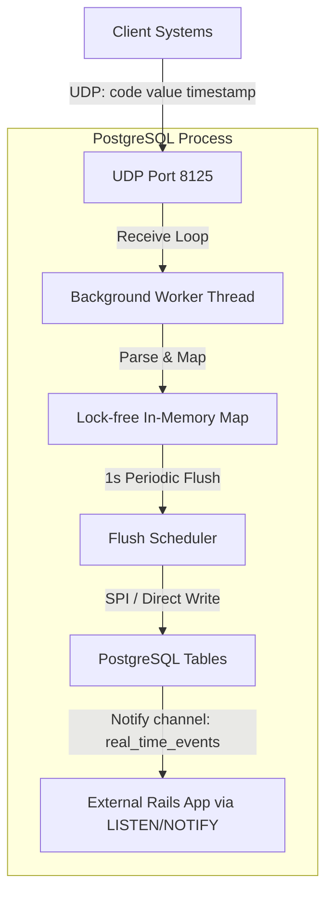

# Architecture

`stat-pg` is a custom PostgreSQL extension designed to bypass traditional application pipelines and insert triggers to achieve ultra-fast statistical ingestion.

## High-Level Components



## Detailed Execution Flow

### 1. UDP Listener & Background Worker (BGWorker)
PostgreSQL supports spawning independent server processes via background workers. During initialization:
- The background worker binds a socket to a UDP interface and port (defaulting to `0.0.0.0:8125`).
- The worker executes an event loop that continuously calls `recvfrom` (non-blocking or small timeout to handle interrupts).

### 2. In-Memory Aggregation (Accumulators)
Instead of inserting every UDP packet to disk, the background worker maintains an in-memory aggregation map.
- The map key is `(code, resolution_timestamp)`.
- When a packet `api.requests 1 1721237340` is parsed, the worker calculates the timestamp keys for all resolutions (second, minute, hour, day, 30-day).
- It increments the counters in memory. This scales to hundreds of thousands of events per second on a single thread.

### 3. SPI Flush Thread
Every `1.0` seconds (configurable):
- The worker swaps the active aggregation map with a clean one.
- In the background, it translates the aggregated counts into batched SQL queries:
  ```sql
  INSERT INTO evt_secs (code, at, value) VALUES ($1, $2, $3)
  ON CONFLICT (at, code) DO UPDATE SET value = evt_secs.value + EXCLUDED.value;
  ```
- This flush uses the Server Programming Interface (SPI) to commit these updates safely under a local transaction.

### 4. Downstream Broadcasting (SSE Support)
Once the tables are written, the flush routine issues a `NOTIFY real_time_events` statement containing JSON payloads of the updated second-level metrics. Any subscribing clients (like a Rails application or Node daemon) can consume this channel via `LISTEN` and immediately stream updates to user browsers using Server-Sent Events (SSE).
