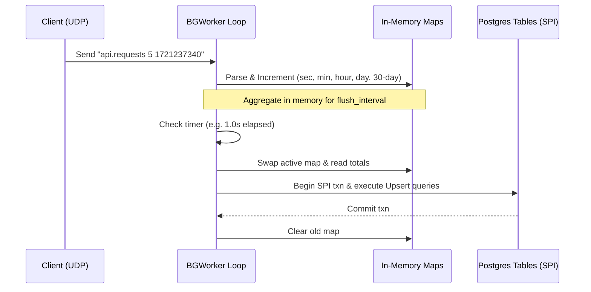

# Plan: 002 - Implement UDP Background Worker

## Goal
Implement a PostgreSQL background worker (BGWorker) in Rust using `pgrx` that binds to a UDP port, aggregates incoming metrics in-memory, and flushes them to the aggregate tables.

## Scope
- **In-Scope**:
  - GUC (configuration parameters) setup for database, user, port, bind address, and flush interval.
  - BGWorker lifecycle registration (`_PG_init`).
  - Safe UDP socket binding and non-blocking polling loop.
  - Thread-safe or process-safe in-memory metric accumulator maps.
  - SQL Schema definition inside the extension SQL setup (creating the tables: `evt_secs`, `evt_mins`, etc.).
  - Periodic SPI flush logic that issues batch upserts.
- **Out-of-Scope**:
  - Streaming updates via SSE/ActionCable (to be handled in the Rails application).
  - Advanced parsing patterns (e.g., StatsD tags). We will stick to the basic `code value timestamp` format.

## Architecture

We will configure PostgreSQL to load our extension library `stat_pg` during startup.
The BGWorker thread starts up, reads configuration via GUCs, binds to the UDP port, and runs the event loop:

1. **Receive Phase**: Read packets with a 100ms timeout to ensure the process remains responsive to PG signals (like SIGTERM/SIGHUP).
2. **Accumulation Phase**: Parse packets into `(code, at, value)` and increment the in-memory maps for all 5 resolutions (seconds, minutes, hours, days, 30-days).
3. **Flush Phase**: Every `flush_interval` seconds, connect to SPI and execute batch upserts to update database tables.

## Implementation Steps
Detailed in the `steps/` subdirectory:
- **T001**: GUC settings and BGWorker registration.
- **T002**: UDP listener, packet parsing, and error logging.
- **T003**: In-memory aggregation data structures.
- **T004**: SQL table creation via `extension_sql!`.
- **T005**: SPI flush transaction and batch upserts.
- **T006**: End-to-end verification and performance test.

## Verification Plan
1. Configure `postgresql.conf` in the container to load the extension.
2. Send UDP packets using `nc -u 127.0.0.1 8125`.
3. Check target tables (`evt_secs`, `evt_mins`, etc.) to confirm metrics are aggregated and written.
4. Verify signals (SIGTERM/SIGHUP) gracefully stop or restart the worker.
