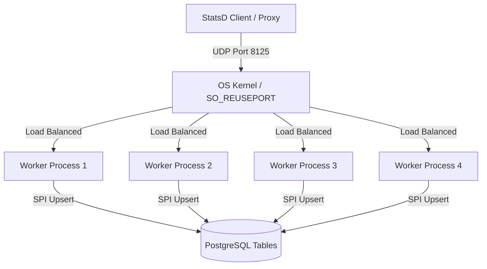

# SO_REUSEPORT Scaling Strategy Design

We want to scale the `stat-pg` ingestion throughput past the single-threaded context-switching limit (~14.5M metrics/second) by introducing horizontal scaling.

---

## Architecture Design

Instead of running a single background worker process, we will spawn **4 concurrent background worker processes** (each process running 1 UDP read thread + 1 database flush thread, yielding 4 read and 4 write threads in total).

### Key Technical Details

1. **`SO_REUSEPORT` Configuration**:
   We will configure our `socket2::Socket` instances with `set_reuse_port(true)` before binding to port `8125`. This allows all 4 processes to bind to the same UDP port concurrently. The OS kernel will distribute incoming UDP packets across the sockets at the network card/driver layer.
   
2. **Deadlock Prevention during Concurrent SPI Upserts**:
   Since multiple worker processes will concurrently perform bulk upserts (`INSERT ... ON CONFLICT DO UPDATE`) to the same rollup tables (`evt_secs` etc.), we must ensure lock ordering to prevent deadlocks.
   Because our flush array is iterated sequentially by index (which maps directly to `metric_id` order), the upsert rows are naturally sorted by `metric_id`. This consistent lock ordering guarantees deadlock-free concurrent execution.

3. **Background Worker Registration**:
   In `_PG_init`, we will register 4 background workers named `stat_pg_aggregator_0` through `stat_pg_aggregator_3`.

---

## Proposed Changes

### [stat-pg library]

#### [MODIFY] [lib.rs](file:///Users/jefflunt/code/stat_pg/src/lib.rs)
- Update `_PG_init` to register 4 background workers instead of 1.
- Update `stat_pg_main` to set `socket.set_reuse_port(true)` using `socket2` before binding.

---

## Verification Plan

### Automated Tests
- Run database test suite inside the container:
  `docker compose exec db cargo test`

### Manual Ingestion Stress Test
- Truncate and vacuum database.
- Run a 2-threaded, 60-second benchmark blasting 1,000 metrics to verify that the delivery rate increases significantly under parallel load:
  `./target/release/stat-pg-bench --threads 2 --duration 60 --metrics 1000`
